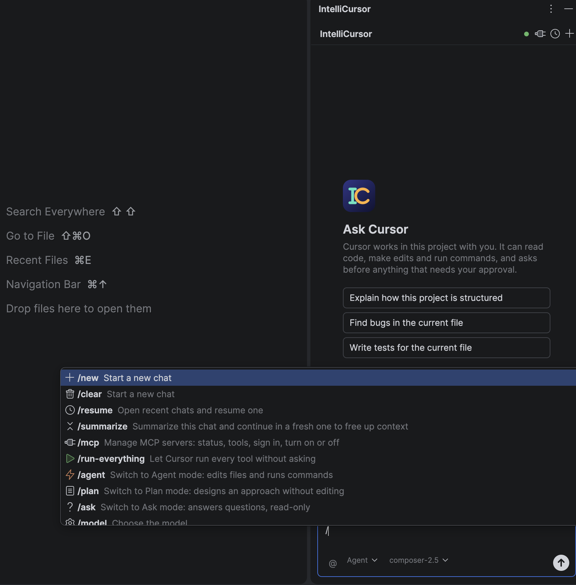
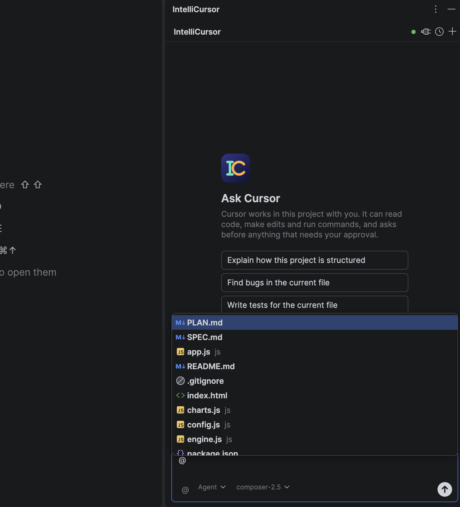

# IntelliCursor

IntelliCursor is an IntelliJ IDEA plugin that runs the [Cursor](https://cursor.com) coding agent in an IDE tool window. It starts the Cursor CLI you already have installed and talks to it over the [Agent Client Protocol](https://agentclientprotocol.com) (ACP), so the agent works on your project the same way it does in a terminal.

> IntelliCursor is an independent project. It is not made or endorsed by Cursor or Anysphere.

<p>
  
  
</p>

## Why

Cursor's agent runs in the Cursor editor or in a terminal. If you work in IntelliJ IDEA, using it means switching windows and losing your editor context. IntelliCursor gives the agent a chat panel inside IntelliJ instead. You can attach files, approve edits and commands, and review the agent's changes in IntelliJ's own diff viewer.

## What it does

- **Chat panel.** Shows your messages and Cursor's replies, with live progress while it thinks, runs tools and writes. Reasoning, tool calls (file reads, searches, edits, terminal commands) and plans each get their own collapsible view.
- **Modes and models.** Switch between **Agent** (edits files, runs commands), **Plan** (designs an approach without editing) and **Ask** (read-only). You can pick any model your Cursor account offers.
- **Context.** The file open in the editor is attached automatically. Type `@` to attach other project files.
- **Slash commands.** `/new`, `/resume`, `/summarize`, `/agent`, `/plan`, `/ask`, `/model`, `/mcp`, `/run-everything`, `/changes`, `/commit`, `/copy`, `/copy-conversation-id`, `/help`. Your Cursor skills and custom commands appear in the same list.
- **Approvals.** Cursor asks before it edits a file or runs a shell command. You can allow once, always allow, or deny. `/run-everything` approves all tools automatically.
- **Chat history.** Reopen and continue earlier chats in the project.
- **MCP servers.** See each server from `mcp.json` with its status, list its tools, sign in, or turn it on or off.
- **Editor actions.** Right-click in the editor and open **IntelliCursor**: *Send Selection to Cursor*, *Explain Selected Code*, *Refactor Selected Code*, *Review Cursor Diff*.

[docs/features.md](docs/features.md) has the full feature list.

## How it works

```
IntelliJ tool window (ui/)  ──►  CursorSessionManager (service/)  ──►  AcpClient (client/)
                                                                          │
                                         JSON-RPC 2.0 over stdio (transport/, protocol/)
                                                                          ▼
                                                              agent --trust acp  (Cursor CLI)
```

1. When a project opens, `CursorStartupActivity` asks `CursorSessionManager` to warm up. If the CLI isn't signed in, the panel shows **Sign in** and waits instead of opening a browser.
2. `CursorProcessLauncher` finds the Cursor CLI and starts `agent --trust acp` (or `cursor agent --trust acp`) in the project directory.
3. `AcpClient` runs the ACP handshake (`initialize`, `authenticate`, then `session/new` or `session/load`). It sends prompts with `session/prompt` and streams `session/update` notifications back to the UI.
4. Permission requests and Cursor's question and plan extensions open as IDE dialogs.
5. Features with no ACP equivalent, such as MCP management and the sign-in check, run one-shot CLI commands through `CursorCli` (`agent mcp list`, `agent status`, and so on).

All CLI I/O runs off the UI thread.

## Prerequisites

- **IntelliJ IDEA 2024.2 or newer**, Community or Ultimate. The plugin declares builds 242 through 263.*.
- **Cursor CLI** with a Cursor account. Install it with:
  ```bash
  curl https://cursor.com/install -fsS | bash
  ```
  The plugin looks for the executable in this order:
  `~/.local/bin/agent`, `~/.local/bin/cursor`, `/usr/local/bin/agent`, `/usr/local/bin/cursor`, `/opt/homebrew/bin/agent`, `/opt/homebrew/bin/cursor`.
- **To build from source:** JDK 21 and Gradle 9.0 or newer. The repository doesn't include a Gradle wrapper, so use a local Gradle installation.

## Installation

### Build the plugin

```bash
git clone https://github.com/ceasle/IntelliCursor.git
cd IntelliCursor
gradle buildPlugin
```

This produces `build/distributions/IntelliCursor-1.0.0.zip`.

### Install it in IntelliJ IDEA

1. Open **Settings** (`Cmd+,` on macOS, `Ctrl+Alt+S` on Windows/Linux) and go to **Plugins**.
2. Click the gear icon and choose **Install Plugin from Disk…**.
3. Select `build/distributions/IntelliCursor-1.0.0.zip`, then restart the IDE if prompted.

### Or run it in a sandbox IDE

```bash
gradle runIde
```

This starts a separate IntelliJ IDEA instance with the plugin loaded. Use it for development and testing.

## Usage

1. Open the **IntelliCursor** tool window from the right-hand stripe, or **View → Tool Windows → IntelliCursor**.
2. If the header says **Signed out**, click **Sign in** and finish the login in your browser. If the Cursor CLI is already signed in, the panel goes straight to the chat.
3. Pick a mode (**Agent**, **Plan** or **Ask**) and a model, type a message and press **Enter**.

### Example workflow

1. Open a file you want to change, select a function, right-click and choose **IntelliCursor → Refactor Selected Code**.
2. Cursor proposes a refactoring in the chat. Switch to **Agent** mode and reply "Apply it and add a test."
3. When Cursor wants to edit a file or run the tests, an approval dialog opens. Choose **Allow Once**.
4. Watch the tool cards as Cursor edits files and runs commands.
5. Type `/changes` (or use **IntelliCursor → Review Cursor Diff**) to review the edits in IntelliJ's diff viewer.
6. Type `/commit` to have Cursor stage and commit the changes, or commit them yourself.

## Project structure

```
src/main/kotlin/com/ceasle/intellicursor/
├── actions/     Editor right-click actions: send, explain, refactor, review diff
├── client/      AcpClient: ACP handshake, sessions, prompts, event dispatch
├── protocol/    ACP message models, Cursor extensions, JSON-RPC codec (Jackson)
├── service/     CursorSessionManager (project service), CursorCli, startup activity, session state
├── transport/   Locates and launches the Cursor CLI; stdio JSON-RPC transport
└── ui/          Tool window, chat bubbles, composer, tool/plan/thinking panels, dialogs, popups
src/main/resources/
├── META-INF/plugin.xml   Plugin ID, tool window, services, editor actions
└── icons/                Tool window and avatar icons
src/test/kotlin/          JUnit 5 tests for protocol, transport, client, session state and UI
docs/                     Feature list and README screenshots
```

## Customization

There's no settings page yet. To change the plugin's behavior, edit the source and rebuild:

- **CLI location.** Add search paths in `findAgentExecutable` in `transport/CursorProcessLauncher.kt`.
- **Slash commands.** Built-in commands are the `LocalCommand` entries in `ui/CursorAgentPanel.kt`.
- **Starter prompts.** These are defined in the empty-chat screen in `ui/CursorAgentPanel.kt`.
- **Editor action prompts.** Change the prompt text in `actions/ExplainCodeAction.kt` and `actions/RefactorCodeAction.kt`.
- **Supported IDE versions.** Change `sinceBuild` and `untilBuild` in `build.gradle.kts`, and the platform version in `gradle.properties`.
- **MCP servers.** These are configured by Cursor, not the plugin. Edit `.cursor/mcp.json` in your project, or `~/.cursor/mcp.json`. `/mcp` → **Edit mcp.json…** opens it.

## Contributing

Contributions are welcome. See [CONTRIBUTING.md](CONTRIBUTING.md) for how to build, test and submit changes.

## License

Released under the [MIT License](LICENSE).
